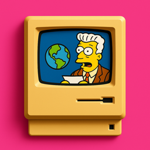
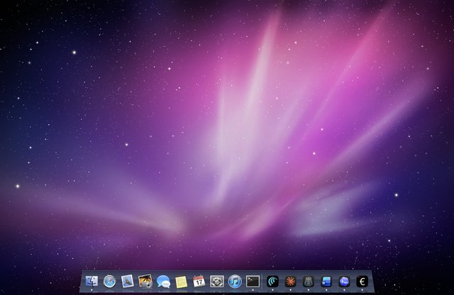

  
  <h1 align="center">RetroMac Snow Leopard</h1>
  
<strong>The look of Mac OS X 10.6 on your Mac, in one click. A free taste of <a href="https://myretromac.app/?ref=snowleopard">RetroMac</a>.</strong>

  
  
  
  

Open it and your Mac wears Snow Leopard: the glass Dock with its reflections, the space wallpaper, the desktop icons and widgets of the time. Quit it and everything is as it was.

No settings, no permissions, no updates to manage. It is one theme of [RetroMac](https://github.com/klotzbrocken/RetroMac), on its own.

## Install

1. Download **[RetroMac-Snow-Leopard.dmg](https://github.com/klotzbrocken/RetroMac-Snow-Leopard/releases/latest/download/RetroMac-Snow-Leopard.dmg)**.
2. Drag **RetroMac Snow Leopard** into **Applications** and open it. The app is signed and notarized by Apple.

## Leave

Any of these quits it and puts your Dock and desktop picture back:

- **⌘Q**
- the **RetroMac** icon in the Dock (click for the menu)
- the **Apple menu ▸ Return to macOS…**
- a **right-click on the desktop ▸ Return to macOS**

## What it changes

Only two things, and both come back when you quit: your **desktop picture**, and the **macOS Dock**, which is hidden while the theme's own Dock is up. Even if the app should crash, the macOS Dock still appears when you rest the pointer at the bottom edge for three seconds. It asks for no permissions and changes no other system settings.

## Want more?

[RetroMac](https://myretromac.app/?ref=snowleopard) has 26 more eras, from System 6 and Mac OS 9 to Windows 98, XP and BeOS, with CRT shaders, working taskbars and Start menus, classic games and sounds. It is free too.

## Source and license

RetroMac Snow Leopard is built from RetroMac's code, branch [`single-click-app`](https://github.com/klotzbrocken/RetroMac/tree/single-click-app) (`EDITION=snowleopard ./build.sh release`). Free software under the [GNU General Public License v3.0](LICENSE).

An independent fan project, not affiliated with or endorsed by Apple Inc. Mac, macOS and Mac OS X are trademarks of Apple Inc.
